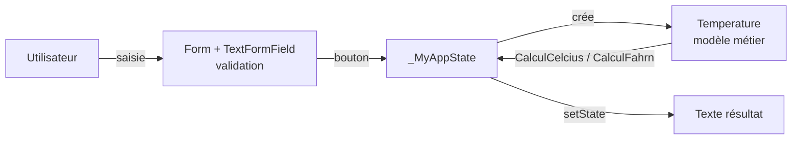

# Convertisseur de température — Flutter

Application mobile **Flutter** qui convertit une température saisie entre **Celsius** et **Fahrenheit**, avec validation du formulaire et affichage du résultat en temps réel.


---

## Fonctionnalités

- Saisie d'une température au clavier numérique
- Validation du formulaire : message d'erreur si le champ est vide
- **TO CELCIUS** : °F → °C avec `(t − 32) × 5/9`
- **TO FAHRENHEIT** : °C → °F avec `t × 9/5 + 32`
- Mise à jour immédiate du résultat (`setState`)

## Architecture



| Fichier | Rôle |
|---|---|
| `main.dart` | Interface : `MaterialApp`, `Scaffold`, formulaire, boutons, état (`StatefulWidget`) |
| `Temperature.dart` | Modèle métier : la logique de conversion, séparée de l'UI |

Points mis en œuvre : widgets *stateful*, `GlobalKey<FormState>` pour la validation, `TextEditingController`, séparation **UI / logique métier**.

## Lancer le projet

**Prérequis :** [Flutter SDK](https://docs.flutter.dev/get-started/install)

```bash
flutter create temp_converter
cd temp_converter
# Copier main.dart et Temperature.dart dans lib/
```

Dans `lib/main.dart`, remplacer l'import :

```dart
import 'package:untitled7/Temperature.dart';   // avant
import 'Temperature.dart';                      // après
```

Puis :

```bash
flutter run
```

## Pistes d'amélioration

- Ajouter `pubspec.yaml` et la structure `lib/` pour un projet directement exécutable
- Remplacer `ElevatedButton.styleFrom(primary: …)`, déprécié, par `backgroundColor: …`
- Ajouter des tests unitaires sur la classe `Temperature`
- Ajouter le Kelvin et une capture d'écran de l'application

## Auteur

**Saad Mekraz** — [GitHub](https://github.com/saadmekraz)
